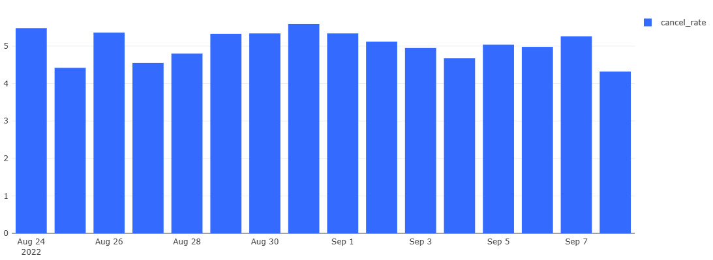
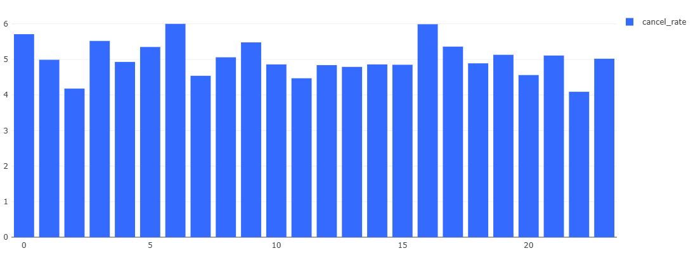

# Кейс 1. Воронка заказов и анализ отмен

## 1. Задача

E-commerce/доставка: пользователь создаёт заказ (`create_order`),
иногда отменяет (`cancel_order`). Нужно понять, насколько
эффективна воронка заказа и где теряются заказы.

**Бизнес-вопрос:** какая доля созданных заказов отменяется,
и можно ли снизить отмены?

**Период данных:** 24.08.2022 – 08.09.2022 (16 дней).

## 2. Данные

| Таблица | Поля | Описание |
|---|---|---|
| `user_actions` | user_id, order_id, action, time | журнал действий с заказами |
| `users` | user_id, birth_date, sex | справочник пользователей |

**Ограничения:**
- период короткий (~11 дней) — retention в днях считается, но с оговоркой;
- нет суммы заказа — monetary-метрики недоступны;
- есть пропуски в `birth_date` и даты рождения вне разумного диапазона.

## 3. Метод

- Единица анализа — **заказ (`order_id`)**, а не строка журнала
  и не пользователь: один заказ может иметь несколько строк действий.
- **Cancel rate** = отменённые заказы / все созданные заказы × 100%.
- Заказ считается отменённым, если по его `order_id` есть хотя бы
  одна строка `cancel_order`.

## 4. Результаты

### 4.1. Общая воронка

| Метрика | Значение |
|---|---|
| Создано заказов (`total_orders`) | **59 595** |
| Отменено (`cancel_orders`) | **2 979** |
| **Cancel rate** | **≈ 5,0 %** |
| Success rate | ≈ 95,0 % |

**Инсайт:** каждый двадцатый заказ отменяется. Базовая метрика,
от которой отталкиваемся дальше.

### 4.2. Отмены по дням

Cancel rate стабилен по дням: 4,3–5,6%, без аномальных всплесков. Средний за период — ≈5,0%. Крайние дни (24.08 и 08.09) неполные — объём заказов в них занижен из-за обрезки данных, поэтому по объёму их нельзя сравнивать с полными днями; при этом cancel rate в них остаётся в общем коридоре. Стабильность метрики говорит о том, что отмены — системная характеристика, а не следствие одного инцидента. Дальше проверяем часы суток и время до отмены.

### 4.3. Отмены по часам

Cancel rate стабилен в течение суток: **4,1–6,0 %** при среднем ~5,0 %.
Резких всплесков нет — отмены **не привязаны ко времени суток**.

Локальные максимумы:
- 06:00 — 6,00 % (выборка малая: 1 684 заказа, в 2–3 раза меньше
  дневных; отклонение в пределах шума — вывод «утром отменяют чаще»
  делать нельзя);
- 16:00 — 5,99 % (выборка нормальная, отклонение ~1 п.п. — на грани
  значимости, на 16 днях данных скорее случайность).

**Вывод:** причина отмен **системная**, а не связана с конкретным
временем суток. Искать надо в поведении пользователя (время до отмены)
и в сегментах (пол, возраст).

### 4.4. Время до отмены

**Ограничение данных:** поле `time` имеет точность до минуты
(секунды отсутствуют), поэтому точное время до отмены измерить
нельзя — все значения кратны 60 секундам.

По доступным данным:
- минимальная разница create → cancel: ~3 минуты;
- медиана: **~6 минут**;
- среднее: ~6 минут (распределение симметричное);
- максимум: ~10 минут — **все отмены происходят в первые 10 минут**
  после создания заказа.

**Интерпретация:** с учётом гранулярности времени это означает,
что отмены **концентрируются в первые минуты** после оформления.
Гипотеза: значительная часть — «быстрые» отмены (передумал сразу,
ошибка в заказе, сбой оплаты). Проверить точнее (есть ли отмены
в первые секунды — технические) **невозможно** из-за точности данных.

**Рекомендация:** для точного анализа времени до отмены нужны
данные с точностью до секунды. С текущими данными можно утверждать
только, что отмены — **ранние (в пределах 10 минут)**.

### 4.5. Сегментация: пол и возраст

| age_group | sex | create_orders | cancel_orders | cancel_rate |
|---|---|---|---|---|
| <25 | male | 667 | 24 | 3,60 % |
| <25 | female | 682 | 42 | 6,16 % |
| 25–34 | male | 26 392 | 1 315 | 4,98 % |
| 25–34 | female | 26 222 | 1 330 | 5,07 % |
| 35–44 | male | 1 239 | 65 | 5,25 % |
| 35–44 | female | 1 171 | 61 | 5,21 % |
| unknown_birthdate | male | 64 | 0 | 0,00 % |
| unknown_birthdate | female | 71 | 1 | 1,41 % |
| no_user_record | — | 3 087 | 141 | 4,57 % |

**Инсайты:**
- 88 % заказов — от пользователей 25–34 лет; остальные группы малы,
  их cancel rate менее надёжен.
- В зрелых группах (25–34, 35–44) **пол не влияет** на cancel rate:
  разница < 0,1 п.п.
- У молодых (<25) разница между полами формально значима
  (chi-square, p = 0,04): female 6,16 % vs male 3,60 %. Однако выборки
  малы (667 и 682 заказа), при поправке на множественные сравнения
  (6 групп, Бонферрони α ≈ 0,008) разница не проходит порог, размер
  эффекта 2,6 п.п. **Вывод: гипотеза требует проверки на большей
  выборке; для продуктовых решений недостаточно оснований.**

**Ограничение:** 3 228 заказов (5,4 %) — от пользователей вне
справочника `users`; демографии нет, в сравнении по полу/возрасту
не участвуют. Их cancel rate (4,57 %) близок к среднему — искажения
общей картины нет.

## 5. Data quality

_(заполнить по `data_quality.md`: пропуски birth_date, дубли
строк create/cancel по одному order_id, заказы с cancel раньше create,
возрасты вне диапазона)_

## 6. Рекомендации

_(по 1 пункту на каждый найденный инсайт. Пример формата:
«X% отмен происходят в течение N минут после создания — похоже
на технические отмены, стоит добавить подтверждение заказа / 
замерить долю ошибочных нажатий»)_

## 7. Ограничения анализа

- Период 16 дней — сезонность и долгосрочный retention оценить нельзя.
- Нет суммы заказа — нельзя считать выручку и LTV.
- Нет данных о причине отмены — гипотезы требуют проверки на продукте.

## 8. SQL-запросы

Все запросы — в [`queries.sql`](./queries.sql). Ключевой:

_(вставить финальный запрос воронки с комментариями)_
